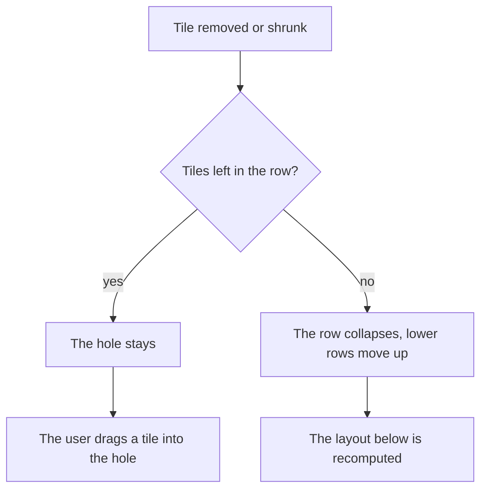
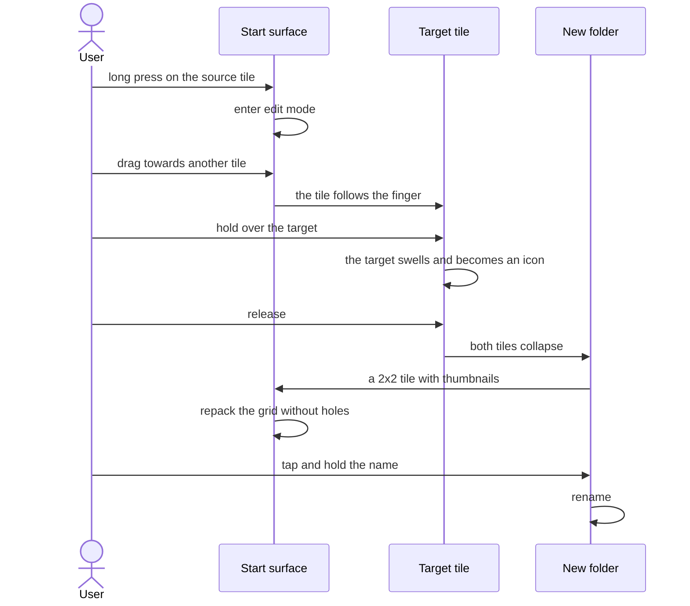
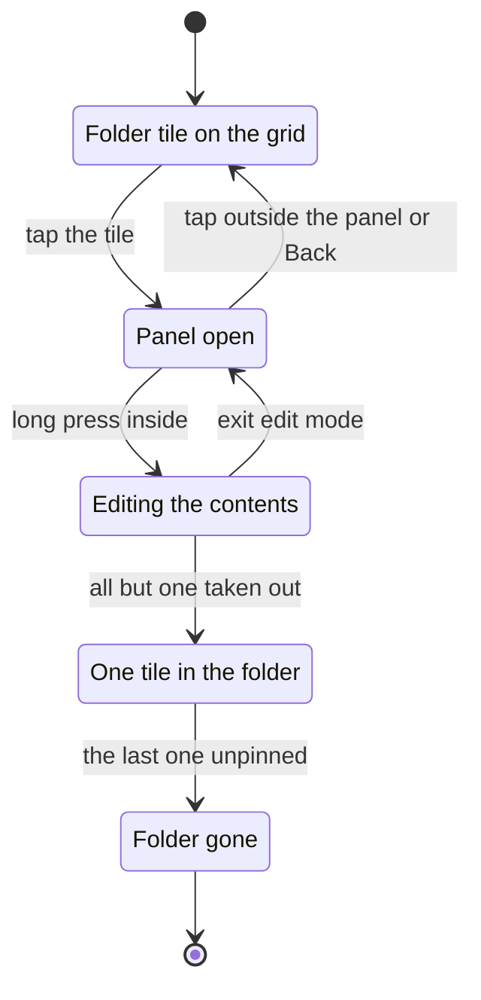
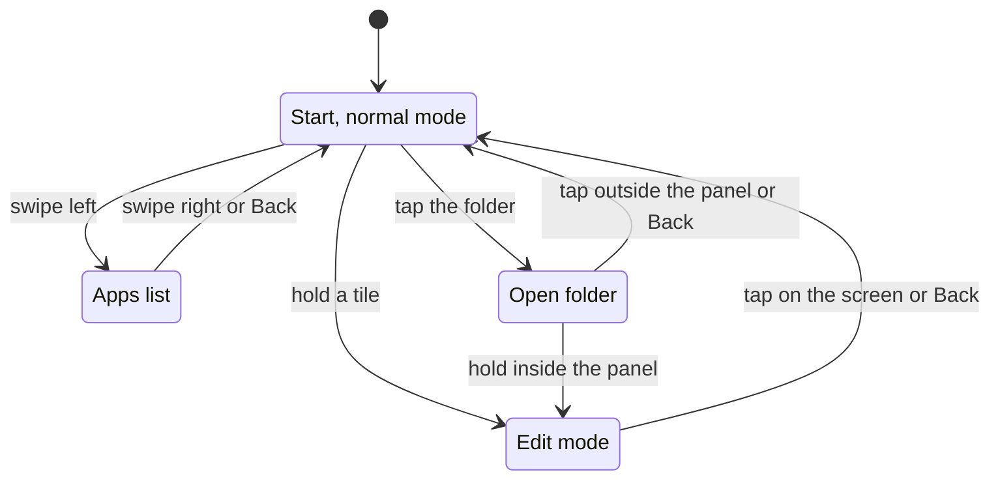

# The Windows 10 Mobile start screen: how it works

> Windows Phone and Windows 10 Mobile are trademarks of Microsoft Corporation. TesseraKit is an independent open-source project and is not affiliated with, endorsed by or sponsored by Microsoft. This document is a behaviour reference compiled from public documentation and third-party reviews; quotations are kept short and everything else is paraphrased.

This document describes the structure and behaviour of the start screen ("Start") of Windows 10 Mobile (W10M), Microsoft's mobile OS of 2015–2017, mainly builds 10586 (November 2015) and 14393 (summer 2016). It is an engineering reference, not a user guide or a specification for TesseraKit: it summarizes what objects the shell consists of, by what rules tiles are laid out, and how the modes behave. Every statement is marked by its reliability, and disagreements between sources are called out.

**Reliability markers.** `[spec]` means Microsoft documentation, a device manual, a manifest or layout markup. `[observed]` means matching descriptions in independent reviews, videos and guides. `[undocumented]` means an inference from indirect evidence. A marker applies to the nearest statement and is kept when wordings are merged. A combined marker such as `[spec]`/`[observed]` means that different parts of one statement rest on different kinds of sources: for example, the size of a folder is confirmed by the markup, while its behaviour comes from reviews.

## Contents

- [1. Model: app, tile, page](#1-model-app-tile-page)
- [2. Grid and geometry](#2-grid-and-geometry)
- [3. Layout: order, packing, holes](#3-layout-order-packing-holes)
- [4. Normal mode](#4-normal-mode)
- [5. Edit mode](#5-edit-mode)
- [6. Folders](#6-folders)
  - [6.1 Origin and model](#61-origin-and-model)
  - [6.2 Creating a folder](#62-creating-a-folder)
  - [6.3 The folder tile in normal mode](#63-the-folder-tile-in-normal-mode)
  - [6.4 Opening and closing the panel](#64-opening-and-closing-the-panel)
  - [6.5 Working inside the panel](#65-working-inside-the-panel)
  - [6.6 Editing the contents](#66-editing-the-contents)
  - [6.7 Renaming](#67-renaming)
  - [6.8 Folder size](#68-folder-size)
  - [6.9 Dissolving and removal](#69-dissolving-and-removal)
  - [6.10 Limits and edge cases](#610-limits-and-edge-cases)
  - [6.11 Timings and animations](#611-timings-and-animations)
- [7. Gestures and transitions](#7-gestures-and-transitions)
- [8. Differences from Windows Phone 8.1](#8-differences-from-windows-phone-81)
- [9. Sources](#9-sources)

## At a glance

- Start is a single vertical ribbon of tiles; there are no horizontal pages or "screens".
- A tile is a multiple of the small cell: 1×1, 2×2, 4×2; 4×4 exists in the layout schema, but the phone UI does not offer it.
- The base grid of 14393 is 6 columns × 20 rows; rows 0–9 are "above the fold".
- "Show more tiles" widens the grid to 8 small columns and physically shrinks the tiles.
- Start does not rotate to landscape in either 10586 or 14393.
- The grid is not repacked: removing a tile leaves a hole; only a completely emptied row collapses.
- A long press enters edit mode; widgets appear only on the held tile, the others are dimmed.
- The phone has three sizes; the cycle is small → wide → medium → small, and one tap gives one step.
- Unpinning is immediate, without confirmation, and leaves a hole.
- A folder is a container tile created by dragging with a hold; W10M inherited it from Windows Phone 8.1 Update 1.
- Inside a folder is the same grid of tiles; there are no nested folders.
- A live tile holds up to five notifications; in 14393 tiles update synchronously, and a badge of 1–99 is drawn in the bottom-right corner.

## 1. Model: app, tile, page

**App.** An installed package. It reaches Start only after being pinned; everything else is available in the apps list. A tile launches the whole app, not a specific screen `[observed]`.

**Tile.** A rectangular shortcut bound to an app, a secondary tile or a web link. A tile is not an icon: it occupies several grid cells and can carry a name, text, an image and a counter. In the Start layout markup it has `Row`, `Column` and `Size` coordinates `[spec]`.

**Live tile.** A tile whose content is updated by the app through the notification system; a static one shows only a logo and a name. Updates arrive from the notification queue and are drawn within the tile bounds.

**Badge.** A counter of 1–99 (zero clears it) or a system glyph in a tile corner; it is independent of the content and can be updated separately `[spec]`. In W10M the badge sits in the bottom-right corner, in Windows Phone 8.1 in the top-right `[spec]`.

**Sizes.** A tile is always a multiple of the small cell: `small` is 1×1, `medium` 2×2, `wide` 4×2, `large` 4×4 (the `Size` values in the markup) `[spec]`. The schema knows all four values, but the phone UI is limited to three `[spec]`/`[observed]`. The presence of 4×4 in the mobile layout of 14393 is not confirmed: that size belongs to the manifest and the desktop layout.

**Folder.** A container tile: a tap expands it, and inside is a reduced grid of tiles; a folder can be moved and resized like a normal tile `[spec]`. In the markup it is `start:Folder` with mandatory `Size`, `Row`, `Column` and an optional `Name`; the coordinates of its contents are relative to the folder (section 6).

**Start and the apps list.** Start is a vertically scrolling canvas of pinned tiles. The apps list is a separate panel with all apps in alphabetical order, with letter separators `[spec]`. In the list a long press opens the app's context menu (`Pin to start`, `Uninstall`), not grid editing `[spec]`.

**Page.** Start has no pages: it is one ribbon, and "above the fold" means the first rows in view rather than a screen. A "second page" is unreachable; the ribbon can only be scrolled.

## 2. Grid and geometry

**Base layout.** The Start grid is not pixel coordinates but N columns of small cells. In the layout diagram for version 1607 (14393) it is **6 columns × 20 rows**: columns 0–5, rows 0–19, with the fold line between rows 9 and 10, so rows 0–9 are above the fold and rows 10–19 appear on scrolling; partner slots are marked in rows 6–9 and 16–19 `[spec]`. The row count describes the layout, not a capacity limit: the ribbon grows downwards.

| Size | Cells | Asset at 100% | Comment |
|---|---|---|---|
| small | 1×1 | 71×71 | phone-only size `[spec]` |
| medium | 2×2 | 150×150 | base size, required for an app `[spec]` |
| wide | 4×2 | 310×150 | 4 of 6 columns in portrait `[spec]` |
| large | 4×4 | 310×310 | present in the schema, not offered on the phone `[spec]`/`[observed]` |

**Columns.** In portrait the default is 6 small cells, i.e. 3 medium tiles per row. "Show more tiles" (Settings → Personalization → Start) gives 8 small cells, i.e. 4 medium `[observed]`; enthusiasts link this to the `TileColumnSize` key `[observed]`. The number of columns depends on the effective width (resolution × DPI × scale) and the device class; on compact devices the switch may be absent `[observed]`. There is no "width → column count" formula; Lumia 950 reviews report that the fourth column appears with "Show more tiles" at 350% scale and applies after a restart `[observed]`.

**Landscape.** Start in W10M does not rotate: the shell stays portrait and only apps rotate. This holds for 10586 and 14393; a landscape Start existed only in leaked alpha builds of 2015 and in concepts. Microsoft documentation contains no such prohibition, hence `[observed]` (in August 2015 Start rotation was still a user request rather than a feature). Rotation neither rebuilds the grid nor interrupts editing. Continuum is a separate case: Start is shown on a monitor in its desktop form.

**On-screen size.** 71/150/310 epx are reference asset sizes at 100%, not a guaranteed tile size: the grid divides the width into N columns, so at an effective width of 360–400 epx a small tile is noticeably smaller than 71 epx `[undocumented]`. The proportions hold: `wide` is two `medium` widths, `large` is two `medium` heights.

**Gaps and margins.** Only asset sizes are documented. The step is derived from them: 310 ≈ 2×150 + 10, 150 ≈ 2×71 + 8, and six columns of 71 epx with a 6 gap and 12 margins make 480 epx, a reconstruction of the 100% reference grid. In practice the gap is estimated at 6–10 epx and the margin at about 12 epx `[undocumented]`.

**System chrome.** At the top the canvas starts under the status bar, roughly 24–32 epx depending on DPI; on devices with on-screen buttons a navigation bar is added at the bottom `[undocumented]`.

**Scale.** The display scale (Settings → System → Display, 300–500%) changes the effective width and the number of columns; it applies after a shell restart `[observed]`.

## 3. Layout: order, packing, holes

**Packing order.** Tiles take coordinates (`Row`, `Column`) from the top-left corner; placement runs top to bottom and left to right `[spec]`.

**Holes are the main property.** The grid is not repacked. If at least one tile remains in a row, tiles below do not move up: after a removal or shrink a hole stays until the user drags another tile into it. Layout-drawing guides built on holes confirm this `[observed]`: Start is a canvas with absolute positions, not a dense list. Caveat: the claim that a row collapses only when completely emptied rests on a single layout analysis (December 2016) `[observed]`.

**Adding.** A new tile appears at the end of the canvas, below the last occupied row, usually as a new row; it is not inserted into the middle or the first hole `[observed]`. For the user-facing "Pin to start" this is not documented: the model is inferred from OEM markup, where tiles pinned by the manufacturer start on a new row at the end of the restored Start `[undocumented]`. Scrolling to the new tile is not confirmed.

**Enlarging.** When a tile changes to a larger size, the OS looks for free space; if there is none, the tile may push the lower ones down or move. The algorithm is undocumented `[undocumented]`; the observable consequence is that neighbours are rearranged while the overall "place in the layout" is preserved.

**Overflow.** The canvas grows downwards and vertical scrolling appears; there are no horizontal pages. A limit on the number of tiles is not documented `[undocumented]`.

**"Show more tiles".** The switch changes the grid from 6 to 8 columns: tiles become smaller and more information fits in view. The layout is recomputed, some positions may shift and expose holes `[observed]`. Switching back does not guarantee the original look: it is a new recomputation, not an undo. There is no compaction: reviews note that after enabling it, rearranging tiles leaves empty spots, i.e. positions are not fitted to the new width `[observed]`.

| Event | What happens to the layout | Status |
|---|---|---|
| Unpinning a tile | a hole in its place; neighbours do not move up | `[observed]` |
| A completely emptied row | rows below move up | `[observed]`, one analysis |
| Enlarging a tile | a search for space, neighbours may shift | `[undocumented]` |
| "Pin to start" | a new row at the end of the ribbon | `[undocumented]`, OEM markup |
| "Show more tiles" | grid recomputation, new holes possible | `[observed]` |

**Consequence.** Because the grid is not repacked, compositions with empty zones are possible: a column at the edge, an "L", a free block. A full-width empty band is unstable; a hole inside a row is stable.

## 4. Normal mode

**Scrolling.** One long vertical surface with inertia and an elastic bounce at the edges. The scroll position is remembered when leaving for an app and restored on return `[observed]`.

**Transition to the apps list.** A swipe left: Start slides out to the left and the list enters from the right; a swipe right, or "Back", returns to Start `[spec]`/`[observed]`. The transition is animated, with background parallax; the duration is on the order of 300 ms `[undocumented]`. The apps list is an adjacent surface rather than part of the ribbon; tiles cannot be dragged between them (section 6.6).

**Background parallax.** The Start background moves slower than the content, both when scrolling vertically and when moving to the list. The factor is undocumented; it is noticeable on high-contrast wallpapers `[observed]`.

**Tap.** Pressing a tile gives a short "press-in" animation, then the app opens; return is via "Back" or a gesture `[observed]`.

**Long press.** Holding a tile (guides say "about a second", in practice closer to 0.4–0.8 s `[undocumented]`) switches Start to edit mode and selects that tile. Some reviews describe a context menu with items such as unpin, resize, turn off live tile and remove, but manuals and analyses record not a list but two corner widgets (see section 5). A list menu on Start is not confirmed; the model "selection + two widgets" is adopted `[spec]`.

**Live tiles.** Content changes with a flip (a rotation around the horizontal axis). An app can keep up to five notifications in the queue and the tile cycles through them; the display interval is system policy `[spec]`. In 14393 all tiles update at once rather than one by one, and can change content and badge simultaneously `[spec]`.

**Start settings.** Personalization → Start has "Show more tiles" and a transparency slider. Personalization → Background offers a full-screen picture or a tiled one; in the second case holes are filled with the theme background, in the first the wallpaper shows through them. Personalization → Colors sets the accent inherited by tiles that support it. The scale is separate, in the display settings `[observed]`.

## 5. Edit mode

**Entering.** The only standard entry is a long press on a Start tile. There is no dedicated button, menu item or entry from the apps list: a long press in the list opens the app's context menu, not grid editing `[spec]`. The manuals' threshold is "about a second" `[spec]`; in practice closer to 0.4–0.8 s `[undocumented]`.

**What is visible.** Triggering selects a single tile: two corner widgets appear on it, unpin in the top-right corner and resize (a diagonal arrow) in the bottom-right; the other tiles are dimmed and get no widgets `[spec]` (confirmed by Lumia and HP manuals; there is no separate evidence for 14393). Another tile must be held separately. Tiles do not wobble and the grid is static `[undocumented]`. Grid lines are not drawn: a hole looks like the Start background, and in "Full screen picture" mode like a fragment of the wallpaper `[observed]`. Entering is animated: the tile grows, gets a shadow and the widgets fade in (timings in section 6.11) `[undocumented]`.

**Live tiles in edit mode.** Only the dimming of unselected tiles is reliable; whether the flip stops and whether the badge is hidden is not established by the primary sources `[undocumented]`.

**Resizing.** Only in edit mode: a tap on the arrow in the bottom-right corner `[spec]`; each tap switches by exactly one next size `[observed]`. On the phone the cycle has three steps: **small → wide → medium → small**. A step-by-step guide (2016) records the transitions explicitly: from medium only small is available, from small wide, from wide medium again; the order "small → medium → wide" in some descriptions is wrong `[observed]`. One tap is one step: after the size changes, the widgets disappear and editing ends, and for the next step the tile must be long-pressed again; the guide shows exactly this, each next size is chosen after a new hold `[observed]`. The arrow direction changes: it shows the next size, not the current one `[observed]`. Start on the phone does not offer the large size (4×4): the manuals list three sizes `[spec]`.

**Size constraints.** The set is limited by the app: the manifest declares logos for the supported sizes, and the markup uses the `TileSmall` / `TileMedium` / `TileWide` / `TileLarge` bindings `[spec]`. Unsupported sizes are probably skipped; with a single size the arrow is either absent or does nothing `[undocumented]`.

**Dragging.** It starts with the same gesture: hold and, without releasing, move the finger; entering edit mode and dragging form one sequence `[observed]`. On lift the tile grows by 5–10%, gets a shadow and slight transparency, and follows the finger `[undocumented]`. Neighbours animate apart to make room under the drop point `[observed]`; this is a rearrangement by cells. On drop the tile takes the cell under the finger and the rest are repacked in the affected rows `[observed]`. Dragging into a hole is allowed: the tile takes the free area and the hole remains `[observed]`. To cancel, put the tile back and release; no separate cancel gesture is described `[undocumented]`. Releasing always completes the rearrangement with snapping to the grid `[observed]`.

**Auto-scroll.** By general expectation, holding a tile at the top or bottom edge auto-scrolls, otherwise a tile could not be moved to the other end of the ribbon. Neither manuals nor reviews describe this behaviour, and no frame-by-frame video analysis was done; its existence and speed profile are treated as undocumented `[undocumented]`.

**Unpin.** Triggered by a tap on the pin in the top-right corner `[spec]`. There is no confirmation or undo: the tile is removed at once and can be restored only by `Pin to start` again, without its previous position `[observed]`. A hole forms in the grid: tiles do not move left and up. The exception is a completely emptied row: if no tile remains in the row, the rows below move up, and if at least one remains, they do not; the rule rests on one detailed layout analysis and is marked as an observation from it `[observed]`. This yields the "column at the edge" and "L" layouts. The tile disappears and, if the row collapses, the rest move up (timings in section 6.11) `[undocumented]`. Unpinning the last tile leaves Start empty `[undocumented]`.

**Adding from the apps list.** In the list, hold an app → `Pin to start` `[spec]`; the app's menu gives the same for a secondary tile. Edit mode does not turn on: the new tile must be held separately `[spec]`. By indirect evidence the tile lands at the end of the ribbon as a new row, not in the first hole, as the OEM markup says about pinned tiles starting on a new row at the end `[undocumented]`. There is no "not enough space" state: the ribbon simply gets longer `[spec]`.

**Edge cases.** Rotation: Start is portrait in 10586 and 14393, so it does not affect editing; the grid is not rebuilt and the gesture is not reset `[observed]`. Locking: after the screen turns off, editing is not restored; no automatic exit on inactivity is recorded `[undocumented]`. Editing in a folder: holding a tile inside gives the same widgets, the tile can be taken out to Start and put back; the folder also resizes and unpins `[observed]` (sections 6.6, 6.9).

**Exit.** No confirmation is needed: W10M has no "Done" button or checkmark `[observed]`. Exit is a tap on the screen (including on free space) or "Back" `[spec]`/`[observed]`. A tap on another tile, by descriptions, also ends editing, but whether the app launches is not established `[undocumented]`. After a resize editing ends on its own; there is apparently no timeout `[undocumented]`.

## 6. Folders

A folder on the W10M start screen is not a file-system object or an app but a container in the desktop model: a set of pinned tiles under one folder tile. The common grid and editing are described in sections 2–5; this section covers what is specific to folders.

### 6.1 Origin and model

Folders did not appear in W10M: they were introduced in **Windows Phone 8.1 Update 1 (GDR1)**, builds `8.10.14141.167` and newer, announced on 30 July 2014. The feature was called "Live folders": the folder tile showed the live tiles of the apps inside, tiles inside could be freely rearranged, and renaming used a field above the opened folder `[spec]`. W10M inherited folders from the first public builds: a review of build 10080 (May 2015) mentions "27 live tiles and one folder" `[observed]`; the 14393 change lists do not mention folders `[spec]`. The wording "folders appeared in W10M" is wrong: they moved into the new shell and markup.

In the Start markup a folder is a `start:Folder` element with mandatory `Size`, `Row`, `Column` and an optional `Name`. Allowed inside are `start:Tile` (UWP), `start:SecondaryTile` (an Edge bookmark) and `start:PhoneLegacyTile` (an old app by ProductID); the coordinates of nested tiles are relative to the folder `[spec]`. `Name` is optional, so a folder may be nameless. The absence of `Folder` among the allowed children means the model has no nested folders (section 6.10).

A folder is a container of the Start model, not a shortcut to a directory: the apps inside stay installed, and unpinning a tile does not uninstall the app `[spec]`. Hence there is no separate "delete folder" operation, only unpinning of the contents.

### 6.2 Creating a folder

**Gesture.** The official wording is to touch a tile and, while holding it, drag it onto another tile or folder to group them `[spec]`. There is no separate command: the gesture starts with the same hold as in edit mode.

The trigger is not the drag itself but **holding over the target**: drag one tile over another and pause briefly; on release the two tiles merge into a folder `[observed]`. How long to hold is undocumented: all sources just say "a moment" `[undocumented]`; an estimate is in section 6.11. If released too early, no folder is created; for the desktop version, if the drag is not finished while the covered tile has grown and looks like an icon, folder creation fails `[observed]`.

| Step | What is visible | Status |
|---|---|---|
| Holding a tile | edit mode starts, size and unpin markers appear, the tile lifts | `[observed]` |
| Dragging | the tile follows the finger, neighbours move apart | `[observed]` |
| Hovering over the target | the target swells and turns into an "icon", a "you can release" signal | `[observed]` |
| Release | both tiles collapse into one, thumbnails appear | `[observed]` |
| Result | a 2×2 tile, neighbours shift to close the freed space | `[undocumented]` (inferred from the general drop behaviour, section 5), size `[spec]` |

There is no sound or haptic feedback for the merge in the documentation `[undocumented]`.

**Which tiles take part.** There is no "only medium/small" restriction: the target is "a tile or a folder" and the source is "a tile" `[spec]`. Tiles of all four schema sizes are allowed inside; Microsoft's example shows 2×2 and 1×1 in one folder `[spec]`. A wide tile (4×2) can also be dragged but stops being wide inside: the folder works with icons, and even apps with live tiles are shown in the usual way inside a folder `[observed]`.

**The result.** The size is 2×2 (medium), as in all schema examples `[spec]`/`[observed]`. The default name is undocumented: `Name` is optional, and in 8.1 Update 1 a text field with the name was above the folder `[spec]`; what text stands there before renaming is not confirmed `[undocumented]`. The original tiles stop being grid elements; the apps work but are represented by thumbnails. The behaviour of neighbours on a user merge is undocumented: merging is a drop of a tile onto a tile, and a drop affects the affected rows (section 5), unlike unpinning (section 3), so a shift into the freed space is expected `[undocumented]`. Microsoft's statement that there will be no gaps and Windows 10 will move the tiles `[spec]` refers to a different case, partner tiles appended to the end of a restored ribbon, not to merging into a folder.

### 6.3 The folder tile in normal mode

A folder tile is a mosaic of thumbnails, not a single icon and not a list. Microsoft calls folders "Live folders" and fixes "some apps' icons being too small on live folders", i.e. small icons are the normal state `[spec]`. The name is shown: for a named folder it stands at the bottom of the tile, like a caption of a normal tile `[observed]`; what is shown on a nameless folder is `[undocumented]`.

How many thumbnails are visible is the most uncertain point. Two hints agree on a grid of four per row: the "invisible folder" trick requires putting 4 empty tiles in the first row of the folder and setting the small size (in 1×1 one row of four is visible) `[observed]`; a MADOSMA review says a small folder holds at most 4 apps `[observed]`. Working model: 1×1 is one row (4), 2×2 is two rows (up to 8), 4×2 is more. The number of rows is undocumented; the model is not fact `[undocumented]`.

Thumbnails update when the folder's content changes; they are the icons of the nested apps `[observed]`. Whether the folder itself is live: in 8.1 Update 1 yes, folders were called "live" precisely because the folder tile showed the live tiles of the nested apps `[spec]`. For W10M sources disagree: some descriptions speak of a static mosaic of icons and no real live-tile information, while an OnMSFT guide (2017) says a medium folder tile cycles through the live tiles of its contents `[observed]`. A badge on a folder tile is not recorded `[undocumented]`.

### 6.4 Opening and closing the panel

Opening is an ordinary **tap** on the tile: to open an app from a folder, tap the folder and then choose the app `[spec]`. A panel with the contents appears and above it the folder name as an editable field: in 8.1 each folder can be renamed by tapping the text field above the open folder, and in W10M the manual records holding the name `[spec]`.

The rest is from observations:

- the panel is an **overlay over Start**, not an app: the background stays and neighbouring tiles are not rearranged `[observed]`;
- inside is the same grid in **4 columns** (four live tiles in one row) `[observed]`;
- when it overflows the panel **scrolls** `[undocumented]`;
- closing is a tap outside the panel and "Back": for 8.1 pressing "Back" collapses the panel `[observed]`; for W10M not confirmed `[undocumented]`;
- the animation is expansion "out of the tile" and the reverse shrink on closing `[observed]`; timings in section 6.11.

An 8.1 edge case: an open folder remains after the screen is locked, and after launching an app and returning with "Back" the same folder is visible `[observed]`. For W10M not confirmed: launching an app probably closes the panel `[undocumented]`.

### 6.5 Working inside the panel

- **Tap on a tile** launches the app. In 8.1 the panel did not close `[observed]`; in W10M it presumably closes, with no direct confirmation `[undocumented]`.
- **Long press** enters editing of the contents: the same common mode applied to the folder `[undocumented]`; consistent with the operations on tiles inside (sections 6.6, 6.9).
- **Dragging inside** is a free rearrangement: tiles inside live folders can be ordered freely `[spec]` (for 8.1); W10M shows the same model.
- **Resizing inside:** per the MADOSMA review, resizing of tiles is supported while an open folder is displayed; the wording also admits the reading "the folder itself is resized", with no separate confirmation for tiles inside. It affects the layout but not the number of tiles `[observed]`.
- There are no nested folders inside (section 6.10).

### 6.6 Editing the contents

The model supported by the sources: **adding from outside, rearranging inside**.

- **Add:** drag a tile onto a **closed** folder tile and hold: the manual says "onto another tile **or folder**" `[spec]`. The folder need not be opened.
- **Rearrange:** open the folder and drag the tiles `[spec]` (for 8.1; W10M shows the same).
- **Take out:** enter content editing and drag a tile from the panel to a free spot on Start. The tile drops into the nearest cell and the panel closes: a tile cannot hang above the overlay. The gesture agrees with the edit-mode observations but is not described separately `[undocumented]`.
- **From the apps list directly:** not possible; the list offers only "pin to start", and the tile is then dragged into the folder. Dragging from the list into a folder in one gesture is not described `[undocumented]`.
- **From folder to folder:** only in two steps (take it out to Start, then drag it into the other); at most one panel is open at a time `[undocumented]`.

### 6.7 Renaming

The documented gesture is to **touch and hold the folder name** and type the new one `[spec]`. In 8.1 the same field was described as a text field above the folder where a tap was enough `[spec]`. The "tap" / "tap and hold" discrepancy between versions is undocumented.

Name restrictions are undocumented: in practice the name is clipped by the width of the title (one line) rather than by character count; an empty string probably restores the default name `[undocumented]`. In provisioning the name is set by `Name` and may be absent `[spec]`. Renaming changes neither size nor contents.

### 6.8 Folder size

A folder tile is an ordinary tile and takes part in the common resizing. The schema allows for `start:Folder` the same `Size` values: 1×1, 2×2, 4×2, 4×4 `[spec]`. The W10M UI offers **three** sizes: small, medium, wide; large (4×4) does not occur in the mobile Start: the asset documentation marks it as a desktop-only size `[spec]`.

| Size | What is visible | Status |
|---|---|---|
| 1×1 (small) | one row of thumbnails (4); the review says "at most 4 apps" | `[observed]` |
| 2×2 (medium) | 2 rows × 4 = up to 8, an estimate | `[undocumented]` |
| 4×2 (wide) | more thumbnails per row | `[undocumented]` |
| 4×4 (large) | unavailable in the W10M UI, valid in the schema | `[spec]` |

Size does not affect the **number** of tiles: there is no capacity limit, only the presentation changes, and "at most 4 in a small folder" is rather about visibility `[undocumented]`. Tiles are not re-sorted: the panel layout is preserved, only the visible thumbnails and the scroll zone change `[undocumented]`. A folder resize follows the same cycle as a normal tile (section 5), with the same caveat: after a step editing ends.

### 6.9 Dissolving and removal

- There is no separate "delete folder" command: to delete a folder, unpin the tiles in it, one by one `[spec]`.
- **An empty folder does not exist:** after the last tile is unpinned the folder disappears. For the desktop version, a folder is destroyed when it becomes empty, but all tiles must be taken out `[observed]`; for mobile this follows from the same manual wording, which has no direct "the folder disappears" `[spec]`.
- **One tile left** is a state the sources do not describe. By analogy with the desktop version the folder stays with one thumbnail; the documentation does not provide for turning it into a single tile `[undocumented]`.
- **Unpinning the folder itself** is not offered by the manual, only unpinning the tiles in it `[spec]`. In edit mode the folder tile gets the same markers as an ordinary one, and by observations also its own unpin `[observed]`. What happens to the contents is undocumented `[undocumented]`.
- **Collapse.** When a folder tile disappears, by the general rules a hole remains: the grid is not repacked (section 3). A statement that "the grid closes the gap" from one animation description contradicts the general rule; the hole rule is adopted `[observed]`.

### 6.10 Limits and edge cases

- **Nested folders:** none. Only `Tile`, `SecondaryTile` and `PhoneLegacyTile` are allowed in a folder; `Folder` inside `Folder` is not provided for `[spec]`. Dragging a folder onto a folder does not create nesting: it is either ignored or moves the folder tile like an ordinary one `[undocumented]`.
- **Tile limit** is not set; folders with dozens of apps exist `[undocumented]`.
- **Screen edge:** a folder is a whole tile (2×2 by default); the contents are not clipped partially `[undocumented]`.
- **Dragging the folder as a whole** is by the folder tile, not the contents; inside the panel such a gesture is impossible `[observed]`.
- **Rotation:** Start is portrait, the grid is not rebuilt, and the folder keeps its position and size `[observed]`.
- **Loss of layout:** build 15063.674 fixed an issue where personalization, such as pinned tiles, was lost on upgrading to Windows 10 1703 `[spec]`. In such a scenario folders are lost together with the layout `[undocumented]`.

### 6.11 Timings and animations

| Event | What happens | Timing |
|---|---|---|
| Entering edit mode | the tile grows, widgets appear | `[undocumented]`, ~150–300 ms |
| Hovering over the target in a drag | the target swells and becomes an "icon" | threshold `[undocumented]`, ~0.5–1 s |
| Folder creation | tiles collapse, thumbnails appear | `[undocumented]`, ~150–300 ms |
| Opening a folder | the panel grows out of the tile | `[undocumented]`, ~200–300 ms |
| Closing a folder | reverse shrink into the tile | `[undocumented]`, ~150–250 ms |
| Resizing a tile | the dimensions change, neighbours rearrange; no animation in 10586, a smooth transition in Redstone builds `[observed]` | `[undocumented]`, ~200–300 ms |
| Unpinning | the tile disappears; when a row collapses neighbours move up | `[undocumented]`, ~150–250 ms |
| Taking a tile out of a folder | the thumbnail "stretches" into a full-size tile | `[undocumented]` |
| Folder dissolving | the tile disappears, a hole remains in its place | `[undocumented]` |

No timing in milliseconds is confirmed: the sources say only "a moment", "smoothly", "with an animation". The ranges are an estimate from typical shell durations, not a measurement `[undocumented]`.

## 7. Gestures and transitions

A summary table of gestures; details of the transitions are in sections 4, 5 and 6.

| Gesture | Context | Result |
|---|---|---|
| Swipe up or down | Start | scrolls the canvas; the background shifts with parallax |
| Swipe left | Start | the apps list enters from the right |
| Swipe right | Apps list | return to Start |
| Tap | Tile | launches the app with a press animation |
| Tap | Folder tile | expands the panel with tiles |
| Tap | Outside the folder panel | closes the panel |
| Long press | Start tile | enters edit mode, two corner widgets |
| Long press | Apps list | app context menu (Pin to start, Uninstall), not editing |
| Hold and move | Tile in edit mode | the tile follows the finger, neighbours move |
| Release over another tile | Tile in edit mode | rearrangement: the tile takes the cell under the finger |
| Release after holding over a tile | Tile in edit mode | folder creation, the target swells |
| Release over empty space | Tile in edit mode | the tile takes the hole, the hole remains |
| Hold at the top or bottom edge | Tile in edit mode | auto-scroll `[undocumented]` |
| Tap on the arrow in the bottom-right corner | Tile in edit mode | next size: small → wide → medium → small |
| Tap on the pin in the top-right corner | Tile in edit mode | immediate unpin, a hole in the grid |
| Tap on the screen | Edit mode | exits edit mode |
| Long press on the name | Folder open | rename |
| Long press on a tile | Folder open | edit the folder contents |
| Drag a tile inside | Folder open | rearrange the tiles |
| Drag a tile out | Content editing | the tile goes to Start, the panel closes `[undocumented]` |

## 8. Differences from Windows Phone 8.1

- **Folders are not new in W10M.** They appeared in **Windows Phone 8.1 Update 1 (GDR1)** under the name "Live folders" (section 6.1) `[spec]`: live tiles on the folder tile, free rearrangement inside, renaming through a field above the open folder. W10M merely moved them into the new shell and markup (`start:Folder`); they are first visible in public build 10080 (May 2015) `[observed]`. "WP 8.1 had no folders" is wrong.
- **Number of sizes.** WP 8.1 had three sizes. The W10M schema and manifest have a fourth, `large` 4×4, but the phone Start does not offer it `[spec]`: it is a property of the markup and the desktop layout, not the mobile UI.
- **Badge.** In WP 8.1 the counter was drawn in the top-right corner, in W10M in the bottom-right `[spec]`.
- **Live tiles.** In 14393 tiles update synchronously rather than one by one, and the badge can change together with the content `[spec]`.
- **Density.** In WP 8.1 the maximum was 3 medium columns (6 small); 4 medium (8 small) is a W10M feature: 4 columns instead of the previous maximum of 3 `[observed]`.
- **Orientation.** Start is portrait in both WP 8.1 and W10M; there is no landscape in 10586 or 14393 `[observed]`. This is a common trait of the line, not a difference between versions.

## 9. Sources

### Microsoft documentation

- Start layout XML for mobile (archive): https://web.archive.org/web/20200920120847/https://docs.microsoft.com/en-us/windows/configuration/mobile-devices/start-layout-xml-mobile
- Start tile layout, Windows Drivers: https://learn.microsoft.com/en-us/previous-versions/dn772303(v=vs.85)
- TileSize enum: https://learn.microsoft.com/en-us/uwp/api/windows.ui.startscreen.tilesize
- Tile and toast visual assets: https://learn.microsoft.com/en-us/previous-versions/windows/apps/hh781198(v=win.10)
- Create adaptive tiles: https://learn.microsoft.com/en-us/windows/apps/design/shell/tiles-and-notifications/create-adaptive-tiles
- Badge notifications: https://learn.microsoft.com/en-us/windows/apps/develop/notifications/badges
- What's new with live tiles in Windows 10 (badge position, synchronous updates): https://learn.microsoft.com/en-us/archive/blogs/tiles_and_toasts/whats-new-with-live-tiles-in-windows-10
- Using the notification queue: https://learn.microsoft.com/en-us/previous-versions/windows/apps/hh781199(v=win.10)
- Folder ID as a pre-pinned tile type: https://learn.microsoft.com/en-us/previous-versions/windows/hardware/previsioning-framework/mt438228(v=vs.85)
- Lumia Denim / WP 8.1 Update 1 announcement: https://blogs.windows.com/devices/2014/09/04/lumia-denim-update/
- Builds 8.10.14141+: https://learn.microsoft.com/ka-ge/archive/blogs/bernedel/windows-phone-8-1-update-1

### Device manuals

- Microsoft Lumia (W10M), p. 12: https://www.manualslib.com/manual/1060780/Microsoft-Lumia.html?page=12
- Microsoft Lumia (W10M), p. 35: https://www.manualslib.com/manual/1060780/Microsoft-Lumia.html?page=35
- HP Elite x3, p. 17: https://www.manualslib.com/manual/1782555/Hp-Elite-X3.html?page=17
- Microsoft Lumia, full PDF: https://www.appliancesdirect.co.uk/PDFs/A00026067_UserManual1.PDF
- FCC, device manual: https://fccid.io/pdf.php?id=3238806

### Reviews and articles

- P. Thurrott, Customize Start, 18 July 2015: https://www.thurrott.com/mobile/windows-phone/4722/windows-10-mobile-tip-customize-start
- Step-by-step walkthrough of Start, 11 April 2016: https://www.ask-mswin.com/win10mobile-home-screen/
- mobile-review, W10M review: https://mobile-review.com/review/microsoft-windows-10-mobile.shtml
- OnMSFT, Top 5 tips: https://onmsft.com/feature-stories/top-5-tips-setting-windows-10-mobile-start-screen/
- OnMSFT, folders on Start: https://onmsft.com/how-to/how-to-make-folders-on-your-windows-10-start-menu/
- OnMSFT, the fourth column: https://onmsft.com/how-to/enabling-4th-row-live-tiles-lumia-950/
- pikegadge, layout analysis: https://blog.pikegadge.com/win10m-start-customize/
- MSPoweruser on a landscape Start: https://mspoweruser.com/gabe-aul-says-vote-for-landscape-start-screen-if-you-want-it/
- MSPoweruser, Anniversary Update changes: https://mspoweruser.com/full-list-of-new-features-in-the-windows-10-mobile-anniversary-update/
- MSPoweruser, build 14283: https://mspoweruser.com/heres-whats-improved-and-broken-in-windows-10-mobile-build-14283/
- Softpedia, build 10080: https://news.softpedia.com/news/Windows-10-Mobile-Build-10080-Screenshots-481222.shtml
- AAWP, Start layout: https://allaboutwindowsphone.com/features/item/21413_Your_Start_screen_and_tile_lay.php
- Mynavi, MADOSMA Q501A (10586): https://news.mynavi.jp/article/20160122-madosma_02/
- Mynavi, Win10 Tips #183: https://news.mynavi.jp/article/win10tips-183/
- Japanese W10M guide: https://forest.watch.impress.co.jp/docs/serial/w10mguide/1019352.html
- Xataka Windows, four columns: https://www.xatakawindows.com/windows-phone/windows-10-para-moviles-permitiria-usar-hasta-4-columnas-de-tiles-en-la-pantalla-de-inicio
- IT之家, build 10549: https://www.ithome.com/0/183/214.htm
- IT之家, 20 June 2016: https://win10.ithome.com/archiver/234/669.htm
- mobiflip, WP 8.1 Update 1 announcement: https://www.mobiflip.de/windows-phone8-erstes-update-funktionen/
- The Next Web, WP 8.1 Update changelog: https://thenextweb.com/news/everything-microsoft-added-windows-phone-8-1-update
- macerkopf, WP 8.1 Update 1 announcement: https://www.macerkopf.de/2014/07/30/microsoft-kuendigt-windows-phone-8-1-update-1-an/
- dday.it, folders in the Creators Update: https://www.dday.it/redazione/23014/windows-10-creators-update-novita-prova/2/menu-start-e-centro-notifiche
- ITPro Today, folders on Start: https://prod.itprotoday.com/archived-assets/windows-10-creators-update-app-folders-on-the-start-screen
- ASCII, tiles inside a folder: https://weekly.ascii.jp/elem/000/001/479/1479298/
- Microsoft Insider, 15063.674: https://www.microsoftinsider.es/127963/ya-disponible-la-actualizacion-acumulativa-15063-674-windows-10-windows-10-mobile/
- tudocelular, build 14276 resize animation: https://www.tudocelular.com/windows/noticias/n67719/windows-10-mobile-redstone-14276-video.html

### Communities and third-party implementations

- XDA, `TileColumnSize`: https://xdaforums.com/t/howto-shell-mod-tweak.3193612/
- Ten Forums, Show more tiles: https://www.tenforums.com/tutorials/5604-turn-off-show-more-tiles-start-windows-10-mobile-phone.html
- WC Forums, the "invisible folder": https://forums.windowscentral.com/threads/share-your-w10m-start-screens-and-backgrounds.340515/page-87
- WC Forums, folder behaviour: https://forums.windowscentral.com/threads/live-folder-ui-not-consistent.302239/page-2
- The World of Windows, personalization help: https://theworldofwindows.blogspot.com/2017/11/windows-10-mobile-help-personalize.html
- Retiled, diff: https://codeberg.org/DrewNaylor/Retiled/commit/ff3681718232e497e824da588c5d2beba19bd036.diff
- Retiled, PR: https://codeberg.org/DrewNaylor/Retiled/pulls/286
