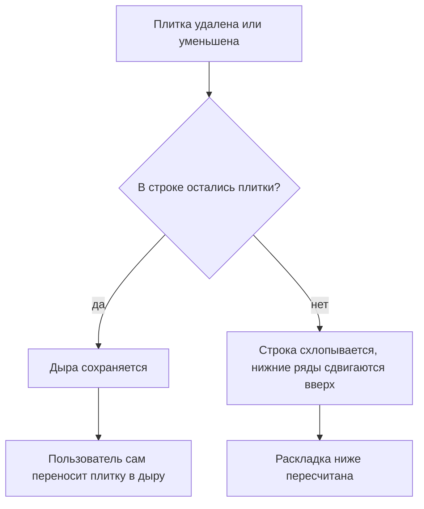
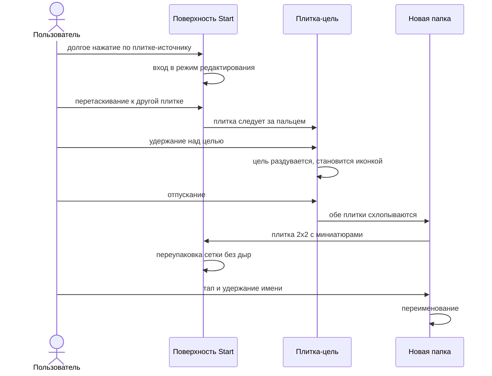
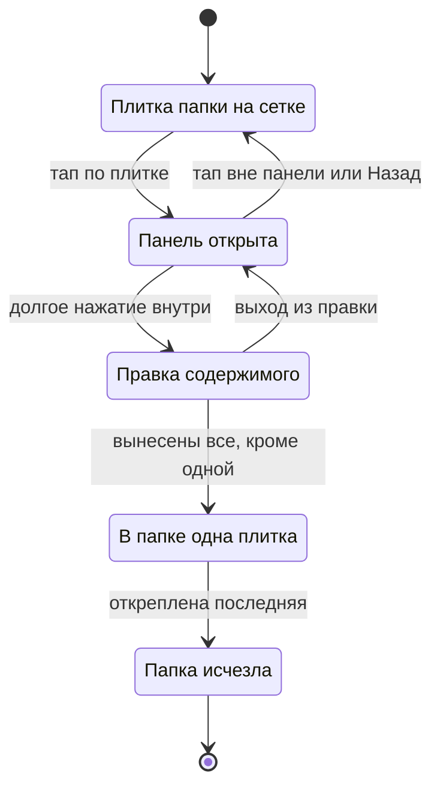
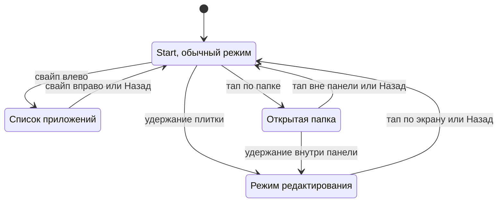

# Рабочий стол Windows 10 Mobile: как он работает

Этот документ описывает устройство и поведение рабочего стола («Пуска») Windows 10 Mobile — мобильной ОС Microsoft 2015–2017 годов, прежде всего сборок 10586 (ноябрь 2015) и 14393 (лето 2016). Это инженерный референс: не инструкция пользователя и не проектное задание, а сводка того, из каких объектов состоит оболочка, по каким правилам раскладываются плитки и как ведут себя режимы. Все утверждения размечены по достоверности, расхождения источников указаны явно.

**Маркировка достоверности.** `[спека]` — документация Microsoft, руководство устройства, манифест или разметка; `[наблюдение]` — совпадающие описания в независимых обзорах, видео и руководствах; `[не документировано]` — вывод по косвенным данным. Маркер относится к ближайшему утверждению и сохраняется при слиянии формулировок. Совмещённый маркер вида `[спека]`/`[наблюдение]` означает, что разные части одного утверждения опираются на разные типы источников: например, размер папки подтверждён разметкой, а её поведение — обзорами.

## Оглавление

- [1. Модель: приложение, плитка, страница](#1-модель-приложение-плитка-страница)
- [2. Сетка и геометрия](#2-сетка-и-геометрия)
- [3. Раскладка: порядок, упаковка, пустоты](#3-раскладка-порядок-упаковка-пустоты)
- [4. Обычный режим](#4-обычный-режим)
- [5. Режим редактирования](#5-режим-редактирования)
- [6. Папки](#6-папки)
  - [6.1 Происхождение и модель](#61-происхождение-и-модель)
  - [6.2 Создание папки](#62-создание-папки)
  - [6.3 Плитка папки в обычном режиме](#63-плитка-папки-в-обычном-режиме)
  - [6.4 Открытие и закрытие панели](#64-открытие-и-закрытие-панели)
  - [6.5 Работа внутри панели](#65-работа-внутри-панели)
  - [6.6 Редактирование содержимого](#66-редактирование-содержимого)
  - [6.7 Переименование](#67-переименование)
  - [6.8 Размер папки](#68-размер-папки)
  - [6.9 Распад и удаление](#69-распад-и-удаление)
  - [6.10 Ограничения и краевые случаи](#610-ограничения-и-краевые-случаи)
  - [6.11 Тайминги и анимации](#611-тайминги-и-анимации)
- [7. Жесты и переходы](#7-жесты-и-переходы)
- [8. Отличия от Windows Phone 8.1](#8-отличия-от-windows-phone-81)
- [9. Источники](#9-источники)

## Коротко

- Start — одна вертикальная лента плиток; горизонтальных страниц и «экранов» нет.
- Плитка кратна малой ячейке: 1×1, 2×2, 4×2; 4×4 есть в схеме разметки, но телефонный интерфейс его не предлагает.
- Базовая сетка 14393 — 6 колонок × 20 строк; строки 0–9 — «above the fold».
- «Show more tiles» расширяет сетку до 8 малых колонок и физически уменьшает плитки.
- Start не поворачивается в ландшафт ни в 10586, ни в 14393.
- Сетка не переупаковывается: после удаления плитки остаётся дыра; схлопывается только полностью опустевшая строка.
- Долгое нажатие входит в редактирование; виджеты есть только на удерживаемой плитке, остальные затемнены.
- Размеров на телефоне три, цикл — малый → широкий → средний → малый, один тап даёт один шаг.
- Открепление происходит сразу, без подтверждения, и оставляет дыру.
- Папка — плитка-контейнер, создаётся перетаскиванием с удержанием; в W10M она унаследована из WP 8.1 Update 1.
- Внутри папки — та же сетка ярлыков; вложенных папок нет.
- Live tile держит до пяти уведомлений; в 14393 плитки обновляются синхронно, badge 1–99 рисуется в правом нижнем углу.

## 1. Модель: приложение, плитка, страница

**Приложение.** Установленный пакет. На рабочий стол оно попадает только после закрепления; остальное доступно в списке приложений. Плитка запускает приложение целиком, а не отдельный экран `[наблюдение]`.

**Плитка (tile).** Прямоугольный ярлык, привязанный к приложению, вторичной плитке или веб-ссылке. Плитка не иконка: она занимает несколько ячеек сетки и может нести имя, текст, картинку и счётчик. В разметке Start у неё есть координаты `Row`, `Column` и размер `Size` `[спека]`.

**Live tile (живая плитка).** Плитка, содержимое которой обновляет приложение через систему уведомлений; статичная показывает только логотип и имя. Обновление приходит из очереди уведомлений и рисуется в границах плитки.

**Badge.** Счётчик 1–99 (ноль снимает счётчик) или системный глиф в углу плитки; он не зависит от контента и может обновляться отдельно от него `[спека]`. В W10M badge стоит в правом нижнем углу, в WP 8.1 — в правом верхнем `[спека]`.

**Размеры.** Плитка всегда кратна малой ячейке: `small` — 1×1, `medium` — 2×2, `wide` — 4×2, `large` — 4×4 (значения `Size` в разметке) `[спека]`. Схема знает все четыре значения, но интерфейс телефона ограничен тремя `[спека]`/`[наблюдение]`. Присутствие 4×4 в мобильной раскладке 14393 не подтверждается: размер относится к манифесту и настольной раскладке.

**Папка.** Плитка-контейнер: тап раскрывает её, внутри лежит уменьшенная сетка плиток; папку можно двигать и менять в размере как обычную плитку `[спека]`. В разметке это `start:Folder` с обязательными `Size`, `Row`, `Column` и необязательным `Name`; координаты содержимого задаются относительно папки (§6).

**Start и список приложений.** Start — вертикально прокручиваемое полотно закреплённых плиток. Список приложений — отдельная панель со всеми приложениями в алфавитном порядке, с буквенными разделителями `[спека]`. В списке долгое нажатие даёт контекстное меню приложения (`Pin to start`, `Uninstall`), а не редактирование сетки `[спека]`.

**Страница.** Страниц у Start нет: одна лента, и «above the fold» — не экран, а первые строки в кадре. «Вторая страница» недостижима, ленту можно только прокрутить.

## 2. Сетка и геометрия

**Базовая раскладка.** Сетка Start — не пиксельные координаты, а N колонок малых ячеек. На схеме макета 1607 (14393) — **6 колонок × 20 строк**: колонки 0–5, строки 0–19, линия сгиба проходит между строками 9 и 10, то есть строки 0–9 — «above the fold», 10–19 открываются прокруткой; партнёрские слоты размечены в строках 6–9 и 16–19 `[спека]`. Число строк — описание макета, а не предел ёмкости: лента растёт вниз.

| Размер | Ячейки | Ассет при 100% | Комментарий |
|---|---|---|---|
| small | 1×1 | 71×71 | только телефонный размер `[спека]` |
| medium | 2×2 | 150×150 | базовый, обязателен для приложения `[спека]` |
| wide | 4×2 | 310×150 | 4 из 6 колонок в портрете `[спека]` |
| large | 4×4 | 310×310 | есть в схеме, в телефоне не предлагается `[спека]`/`[наблюдение]` |

**Колонки.** В портрете по умолчанию 6 малых ячеек, то есть 3 средних плитки в ряд. «Show more tiles» (Параметры → Персонализация → Start) даёт 8 малых ячеек, то есть 4 средних `[наблюдение]`; у энтузиастов это связывается с ключом `TileColumnSize` `[наблюдение]`. Число колонок зависит от эффективной ширины (разрешение × DPI × масштаб) и класса устройства; на компактных аппаратах переключатель может отсутствовать `[наблюдение]`. Формулы «ширина → число колонок» нет; обзоры Lumia 950 сообщают, что четвёртая колонка появляется при включённом «Show more tiles» и масштабе 350%, а применяется после перезапуска `[наблюдение]`.

**Ландшафт.** Start в W10M не поворачивается: оболочка остаётся портретной, крутятся только приложения. Это верно для 10586 и 14393; ландшафтный Start был лишь в утечках alpha-сборок 2015 года и концептах. В документации Microsoft такого запрета нет — маркер `[наблюдение]` (в августе 2015 вращение Start ещё числилось пожеланием пользователей, а не функцией). Поворот не перестраивает сетку и не прерывает правку. Отдельный случай — Continuum, где Start выводится на монитор в настольном виде.

**Размер на экране.** 71/150/310 epx — опорные размеры ассетов при 100%, а не гарантированный размер плитки: сетка делит ширину на N колонок, поэтому при эффективной ширине 360–400 epx малая плитка заметно меньше 71 epx `[не документировано]`. Соотношения сохраняются: `wide` — два `medium` по ширине, `large` — два `medium` по высоте.

**Зазоры и поля.** Документированы только размеры ассетов. Из них выводится шаг: 310 ≈ 2×150 + 10, 150 ≈ 2×71 + 8, а шесть колонок по 71 epx с зазором 6 и полями 12 дают 480 epx — реконструкция опорной сетки 100%. На практике зазор оценивают в 6–10 epx, поля — около 12 epx `[не документировано]`.

**Системный хром.** Сверху полотно начинается под статус-баром — ориентировочно 24–32 epx в зависимости от DPI; на устройствах с экранными кнопками снизу добавляется панель навигации `[не документировано]`.

**Масштаб.** Масштаб (Параметры → Система → Экран, 300–500%) меняет эффективную ширину и число колонок; применяется после перезапуска оболочки `[наблюдение]`.

## 3. Раскладка: порядок, упаковка, пустоты

**Порядок упаковки.** Плитки занимают координаты (`Row`, `Column`) от верхнего левого угла; укладка идёт сверху вниз и слева направо `[спека]`.

**Пустоты — главное свойство.** Сетка не переупаковывается. Если в строке осталась хотя бы одна плитка, плитки ниже не поднимаются: после удаления или уменьшения остаётся дырка, пока пользователь сам не перетащит туда другую. Это подтверждают гайды по «рисованию» раскладки пустотами `[наблюдение]`: Start — холст с абсолютными позициями, а не плотный список. Оговорка: тезис «строка схлопывается только при полном опустошении» держится на одном разборе раскладок (декабрь 2016) `[наблюдение]`.

**Добавление.** Новая плитка появляется в конце полотна, ниже последней занятой строки, обычно новой строкой; в середину или первую дырку она не вставляется `[наблюдение]`. Для пользовательского «Pin to start» это не документировано: модель выводится из OEM-разметки, где закреплённые производителем плитки «начинаются в новой строке в конце восстановленного Start» `[не документировано]`. Прокрутка к новой плитке не подтверждена.

**Увеличение.** При смене размера на больший ОС ищет свободное место; если его нет, плитка может сдвинуть нижние либо переехать. Алгоритм не документирован `[не документировано]`; наблюдаемое следствие — соседи перекладываются, «место в раскладке» в целом сохраняется.

**Переполнение.** Полотно растёт вниз, появляется вертикальная прокрутка; горизонтальных страниц нет. Ограничение на число плиток не документировано `[не документировано]`.

**«Show more tiles».** Переключение переводит сетку с 6 на 8 колонок: плитки становятся меньше, в кадр входит больше информации. Раскладка пересчитывается, часть позиций может «поехать», обнажив пустоты `[наблюдение]`. Обратное переключение исходного вида не гарантирует: это новый пересчёт, а не отмена. Уплотнение не выполняется: обзоры отмечают, что после включения при перестановке плиток остаются пустые места, то есть позиции не подгоняются под новую ширину `[наблюдение]`.

| Событие | Что происходит с раскладкой | Статус |
|---|---|---|
| Открепление плитки | дыра на месте плитки; соседи не подтягиваются | `[наблюдение]` |
| Полностью опустевшая строка | строки ниже сдвигаются вверх | `[наблюдение]`, один разбор |
| Увеличение плитки | поиск места, возможен сдвиг соседей | `[не документировано]` |
| «Pin to start» | новая строка в конце ленты | `[не документировано]`, OEM-разметка |
| «Show more tiles» | пересчёт сетки, возможны новые пустоты | `[наблюдение]` |

**Следствие.** Непереупаковка позволяет собирать композиции с пустыми зонами: колонку у края, «L», свободный блок. Полоса пустоты во всю ширину неустойчива, дыра в строке — устойчива.

## 4. Обычный режим

**Прокрутка.** Одна длинная вертикальная поверхность с инерцией и упругим отскоком на краях. Позиция прокрутки запоминается при уходе в приложение и восстанавливается при возврате `[наблюдение]`.

**Переход к списку приложений.** Свайп влево: Start уезжает влево, список входит справа; свайп вправо возвращает на Start, то же делает «Назад» `[спека]`/`[наблюдение]`. Переход анимирован, с параллаксом фона; длительность — порядка 300 мс `[не документировано]`. Список приложений — соседняя поверхность, а не часть ленты; перетаскивать плитки между ними нельзя (§6.6).

**Параллакс фона.** Фон Start смещается медленнее контента — при вертикальной прокрутке и при переходе к списку. Коэффициент не документирован; заметен на контрастных обоях `[наблюдение]`.

**Тап.** Нажатие плитки даёт короткую анимацию «вдавливания», затем приложение открывается; возврат — «Назад» или жест `[наблюдение]`.

**Долгое нажатие.** Удержание плитки (в руководствах «примерно секунда», фактически ближе к 0,4–0,8 с `[не документировано]`) переводит Start в редактирование и выделяет именно эту плитку. Часть обзоров описывает это как контекстное меню с пунктами «открепить», «изменить размер», «отключить живую плитку», «удалить», однако руководства и разборы фиксируют не список, а два угловых виджета (см. §5). Меню-список на Start не подтверждено; принята модель «выделение + два виджета» `[спека]`.

**Живые плитки.** Контент меняется флипом (переворот вокруг горизонтальной оси). Приложение может держать в очереди до пяти уведомлений, и плитка циклически их показывает; интервал показа — политика системы `[спека]`. В 14393 плитки обновляются все сразу, а не по одной, и могут менять контент и badge одновременно `[спека]`.

**Настройки Start.** Персонализация → Start: «Show more tiles» и ползунок прозрачности. Персонализация → Фон: картинка «на весь экран» либо «плиткой»; во втором случае пустоты заливаются фоном темы, в первом сквозь них видны обои. Персонализация → Цвета: акцент, который наследуют поддерживающие его плитки. Отдельно — масштаб в Параметрах экрана `[наблюдение]`.

## 5. Режим редактирования

**Вход.** Единственный штатный вход — длительное нажатие на плитке Start. Отдельной кнопки, пункта меню или входа из списка приложений нет: долгое нажатие в списке открывает контекстное меню приложения, а не правку сетки `[спека]`. Порог в руководствах — «примерно секунда» `[спека]`; фактически ближе к 0,4–0,8 с `[не документировано]`.

**Что видно.** Срабатывание выделяет одну плитку: на ней появляются два угловых виджета — открепление в правом верхнем углу и изменение размера (диагональная стрелка) в правом нижнем; остальные затемняются и виджетов не получают `[спека]` (подтверждено руководствами Lumia и HP; для 14393 отдельных свидетельств нет). Другую плитку нужно удерживать отдельно. Плитки не качаются, сетка статична `[не документировано]`. Линии сетки не рисуются: пустота выглядит как фон Start, в режиме «Full screen picture» — как фрагмент обоев `[наблюдение]`. Вход анимирован: плитка растёт, получает тень, виджеты проявляются (тайминги — §6.11) `[не документировано]`.

**Live-плитки в правке.** Достоверно только затемнение невыделенных плиток; останавливается ли флип и скрывается ли badge, первоисточники не устанавливают `[не документировано]`.

**Изменение размера.** Только в правке: тап по стрелке в правом нижнем углу `[спека]`; каждый тап переключает ровно на один следующий размер `[наблюдение]`. Цикл на телефоне трёхшаговый: **малый → широкий → средний → малый**. Пошаговое руководство (ask-mswin, 2016) фиксирует переходы явно: из среднего доступен только малый, из малого — широкий, из широкого — снова средний; порядок «малый → средний → широкий» из части описаний неверен `[наблюдение]`. Один тап — один шаг: после изменения размера виджеты исчезают, правка завершается, и для следующего шага плитку нужно снова долго нажать — пошаговое руководство показывает именно это, каждый следующий размер выбирается после нового удержания `[наблюдение]`. Направление стрелки меняется: она показывает следующий размер, а не текущий `[наблюдение]`. Большого размера (4×4) Start на телефоне не предлагает: руководства перечисляют три размера `[спека]`.

**Ограничения размера.** Набор ограничен приложением: манифест объявляет логотипы для поддерживаемых размеров, разметка задаётся привязками `TileSmall`/`TileMedium`/`TileWide`/`TileLarge` `[спека]`. Неподдерживаемые размеры, вероятно, пропускаются; при единственном размере стрелка либо отсутствует, либо ничего не меняет `[не документировано]`.

**Перетаскивание.** Начало — тот же жест: удержать и, не отпуская, повести палец; вход в правку и drag образуют одну последовательность `[наблюдение]`. Подъём: плитка увеличивается на 5–10%, получает тень и лёгкую прозрачность, следует за пальцем `[не документировано]`. Соседи анимированно расходятся, освобождая место под точкой сброса `[наблюдение]`; это перестановка по ячейкам. Сброс — «плитка занимает ячейку под пальцем», остальные переупаковываются в затронутых строках `[наблюдение]`. Тащить в пустоту можно: плитка встаёт в свободную область, дыра сохраняется `[наблюдение]`. Отмена — вернуть плитку на место и отпустить; отдельного жеста отмены не описано `[не документировано]`. Отпускание всегда завершает перестановку с прилипанием к сетке `[наблюдение]`.

**Автопрокрутка.** У верхнего и нижнего края при удержании плитки, по общему ожиданию, работает автопрокрутка, иначе не перенести плитку на другой конец ленты. Однако ни руководства, ни обзоры это поведение не описывают, а покадрового разбора видео не делалось; наличие и профиль скорости считаются недокументированными `[не документировано]`.

**Открепление (unpin).** Вызывается тапом по pin в правом верхнем углу `[спека]`. Подтверждения и отмены нет: плитка удаляется сразу, вернуть можно только повторным `Pin to start`, позиция не восстанавливается `[наблюдение]`. На сетке образуется дыра: плитки не подтягиваются влево и вверх. Исключение — полностью опустевшая строка: если в строке не осталось ни одной плитки, ряды ниже сдвигаются вверх, если осталась хотя бы одна — нет; правило держится на одном подробном разборе раскладок и помечено как наблюдение по нему `[наблюдение]`. Отсюда раскладки «колонка у края» и «L». Плитка исчезает, при схлопывании строки остальные сдвигаются вверх (тайминги — §6.11) `[не документировано]`. Открепление последней плитки оставляет Start пустым `[не документировано]`.

**Добавление из списка приложений.** В списке удержать приложение → `Pin to start` `[спека]`; то же даёт меню программы для вторичной плитки. Режим правки не включается: новую плитку нужно отдельно удержать `[спека]`. По косвенным данным плитка встаёт в конец ленты новой строкой, а не в первую дыру: OEM-разметка говорит, что закреплённые плитки «начинаются в новой строке в конце» `[не документировано]`. Состояния «не хватило места» нет: лента удлиняется `[спека]`.

**Краевые случаи.** Поворот: Start портретный в 10586 и 14393, поэтому на правку он не влияет — сетка не перестраивается, жест не сбрасывается `[наблюдение]`. Блокировка: после выключения экрана правка не восстанавливается; автовыхода по бездействию не зафиксировано `[не документировано]`. Правка в папке: удержание плитки внутри даёт те же виджеты, плитку можно вынести на Start и вернуть; папка тоже меняет размер и открепляется `[наблюдение]` (§6.6, §6.9).

**Выход.** Подтверждение не требуется: кнопки «Done» или галочки в W10M нет `[наблюдение]`. Выход — тап по экрану (в том числе по свободному месту) или «Назад» `[спека]`/`[наблюдение]`. Тап по другой плитке, по описаниям, тоже завершает правку, но запускается ли приложение — не установлено `[не документировано]`. После изменения размера правка завершается сама; таймаута, по-видимому, нет `[не документировано]`.

## 6. Папки

Папка на «Пуске» W10M — не объект файловой системы и не приложение, а контейнер в модели рабочего стола: набор закреплённых плиток под одной плиткой-папкой. Общая сетка и правка описаны в §2–§5; здесь только специфика папок.

### 6.1 Происхождение и модель

Папки появились не в W10M: они введены в **Windows Phone 8.1 Update 1 (GDR1)**, сборки `8.10.14141.167` и новее, анонс 30 июля 2014 года. Функция называлась «Live folders»: на плитке папки отображались живые плитки вложенных приложений, плитки внутри свободно переставлялись, переименование шло через поле над открытой папкой `[спека]`. В W10M папки унаследованы с первых публичных сборок: в обзоре сборки 10080 (май 2015) «27 живых плиток и одна папка» `[наблюдение]`; в списках изменений 14393 папки не упоминаются `[спека]`. Формулировка «папки появились в W10M» неверна: они переехали в новую оболочку и разметку.

В разметке Start папка — элемент `start:Folder` с обязательными `Size`, `Row`, `Column` и необязательным `Name`. Внутрь разрешены `start:Tile` (UWP), `start:SecondaryTile` (закладка Edge) и `start:PhoneLegacyTile` (старое приложение по ProductID); координаты вложенных плиток задаются относительно папки `[спека]`. `Name` опционален, значит папка может быть безымянной. Отсутствие `Folder` среди допустимых детей означает, что вложенных папок в модели нет (§6.10).

Папка — контейнер модели Start, а не ярлык на каталог: приложения внутри остаются установленными, открепление плитки не удаляет приложение `[спека]`. Поэтому отдельной операции «удалить папку» нет — есть только открепление содержимого.

### 6.2 Создание папки

**Жест.** Официально: «коснитесь плитки и, удерживая её, перетащите на другую плитку или папку, с которой хотите её сгруппировать» `[спека]`. Отдельной команды нет: жест начинается с того же удержания в правке.

Триггер — не перетаскивание, а **удержание над целью**: «перетащите одну плитку на другую и задержите на мгновение; когда отпустите, две плитки объединятся в папку» `[наблюдение]`. Сколько держать, не задокументировано: все источники говорят «мгновение» `[не документировано]`; оценка — в §6.11. Если отпустить раньше, папка не создастся; для настольной версии: «если не закончить перетаскивание, пока накрытая плитка увеличилась и стала похожа на иконку, создание папки не удаётся» `[наблюдение]`.

| Шаг | Что видно | Статус |
|---|---|---|
| Удержание плитки | вход в редактирование, маркеры размера и открепления, плитка приподнимается | `[наблюдение]` |
| Перенос | плитка следует за пальцем, соседи расходятся | `[наблюдение]` |
| Зависание над целью | цель раздувается и «иконизируется» — сигнал «можно отпускать» | `[наблюдение]` |
| Отпускание | обе плитки схлопываются в одну, проявляются миниатюры | `[наблюдение]` |
| Результат | плитка 2×2, соседи сдвигаются, закрывая освободившееся место | `[не документировано]` (вывод из общего поведения сброса, §5), размер — `[спека]` |

Звука или виброотклика слияния в документации нет `[не документировано]`.

**Какие плитки участвуют.** Ограничения «только medium/small» нет: цель — «плитка или папка», источник — «плитка» `[спека]`. Внутри допустимы плитки всех четырёх размеров схемы; пример Microsoft показывает в одной папке 2×2 и 1×1 `[спека]`. Широкая плитка (4×2) тоже перетаскивается, но внутри перестаёт быть широкой: папка оперирует значками — «даже приложения с живыми плитками внутри папки отображаются обычным образом» `[наблюдение]`.

**Что получается.** Размер — 2×2 (medium): так во всех примерах схемы `[спека]`/`[наблюдение]`. Имя по умолчанию не документировано: `Name` опционален, а в 8.1 Update 1 над папкой было текстовое поле с именем `[спека]`; какой текст стоит там до переименования, не подтверждено `[не документировано]`. Исходные плитки перестают быть элементами сетки; приложения работают, но представлены миниатюрами. Поведение соседей при пользовательском слиянии не документировано: слияние — это сброс плитки на плитку, а сброс затрагивает затронутые строки (§5), в отличие от открепления (§3), поэтому наблюдается сдвиг к освободившемуся месту `[не документировано]`. Цитата Microsoft «не будет промежутков, Windows 10 сдвинет плитки» `[спека]` относится к другому случаю — партнёрским плиткам, дописываемым в конец восстановленной ленты, а не к слиянию в папку.

### 6.3 Плитка папки в обычном режиме

Плитка папки — мозаика миниатюр, не одна иконка и не список. Microsoft называет папки «Live folders» и чинит «слишком мелкие иконки некоторых приложений на живых папках», то есть мелкие иконки — штатное состояние `[спека]`. Имя показывается: у названной папки оно стоит внизу плитки, как подпись обычной плитки `[наблюдение]`; что выводится на безымянной папке — `[не документировано]`.

Сколько миниатюр видно — самый неопределённый пункт. Две подсказки сходятся на сетке, кратной четырём в ряд: трюк с «невидимой папкой» требует «положить 4 пустые плитки в первую строку папки и выставить маленький размер» (в 1×1 видна одна строка из четырёх) `[наблюдение]`; обзор MADOSMA: «в папку маленького размера помещается максимум 4 приложения» `[наблюдение]`. Рабочая модель: 1×1 — одна строка (4), 2×2 — две строки (до 8), 4×2 — больше. Число строк не документировано; модель — не факт `[не документировано]`.

Миниатюры обновляются при изменении состава папки — это иконки вложенных приложений `[наблюдение]`. Живая ли сама папка: в 8.1 Update 1 — да, папки назывались «live» именно потому, что на плитке отображались живые плитки вложенных приложений `[спека]`. Для W10M источники расходятся: часть описаний говорит о статичной мозаике иконок и отсутствии «нормальной информации живых плиток», инструкция OnMSFT (2017) — что плитка папки среднего размера прокручивает живые плитки содержимого `[наблюдение]`. Бейджа на плитке папки не зафиксировано `[не документировано]`.

### 6.4 Открытие и закрытие панели

Открытие — обычный **тап** по плитке: «чтобы открыть приложение из папки, коснитесь этой папки, а затем выберите нужное приложение» `[спека]`. Появляется панель с содержимым, а над ней — имя папки как редактируемое поле: в 8.1 «каждую папку можно переименовать, коснувшись текстового поля над открытой папкой», в W10M руководство фиксирует удержание имени `[спека]`.

Остальное — по наблюдениям:

- панель — **оверлей поверх Start**, а не приложение: фон остаётся, соседние плитки не перестраиваются `[наблюдение]`;
- внутри та же сетка в **4 колонки** («четыре живые плитки в одном ряду») `[наблюдение]`;
- при переполнении панель **прокручивается** `[не документировано]`;
- закрытие — тап вне панели и «Назад»: для 8.1 «если нажать кнопку „Назад“, панель свернётся» `[наблюдение]`; для W10M не подтверждено `[не документировано]`;
- анимация — раскрытие «из плитки», закрытие — обратное сжатие `[наблюдение]`; тайминги в §6.11.

Краевой случай 8.1: открытая папка остаётся после блокировки экрана, а после запуска приложения и возврата «Назад» видна та же папка `[наблюдение]`. Для W10M не подтверждено: вероятно, запуск приложения панель закрывает `[не документировано]`.

### 6.5 Работа внутри панели

- **Тап по ярлыку** — запуск приложения. В 8.1 панель не закрывалась `[наблюдение]`; в W10M, предположительно, закрывается — прямого подтверждения нет `[не документировано]`.
- **Долгое нажатие** — вход в редактирование содержимого: тот же общий режим, применённый к папке `[не документировано]`; согласуется с операциями с плитками внутри (§6.6, §6.9).
- **Перетаскивание внутри** — свободная перестановка: «внутри живых папок плитки можно свободно упорядочивать» `[спека]` (для 8.1); в W10M наблюдается та же модель.
- **Изменение размера внутри** — по обзору MADOSMA: «при отображении открытой папки поддерживается изменение размера плиток»; формулировка допускает и чтение «меняется размер самой папки», отдельного подтверждения для ярлыков внутри нет. Влияет на раскладку, но не на число ярлыков `[наблюдение]`.
- Вложенных папок внутри нет (§6.10).

### 6.6 Редактирование содержимого

Подтверждаемая источниками модель: **добавление снаружи, перестановка внутри**.

- **Добавить** — перетащить плитку на **закрытую** плитку папки и подержать: руководство говорит «на другую плитку **или папку**» `[спека]`. Открывать папку не нужно.
- **Переставить** — открыть папку и перетащить ярлыки `[спека]` (для 8.1; в W10M наблюдается аналогично).
- **Вынести наружу** — войти в редактирование содержимого и перетащить ярлык из панели на свободное место Start. Ярлык падает в ближайшую ячейку, панель закрывается: плитка не может висеть над оверлеем. Жест согласуется с наблюдениями по правке, но отдельно не описан `[не документировано]`.
- **Из списка приложений напрямую** — нельзя: список даёт только «закрепить на Start», дальше плитка тащится в папку. Перетаскивание из списка в папку одним жестом не описано `[не документировано]`.
- **Из папки в папку** — только в два приёма (вынести на Start, затем перетащить в другую); одновременно открыта максимум одна панель `[не документировано]`.

### 6.7 Переименование

Документированный жест — **коснуться и удерживать имя папки** и ввести новое: «To change the name of the folder, tap and hold the name, and type in the name you want» `[спека]`. В 8.1 то же поле описывалось как текстовое поле над папкой, достаточно тапа `[спека]`. Расхождение «тап» / «тап и удержание» между версиями не документировано.

Ограничения имени не документированы: практически имя обрезается по ширине заголовка (одна строка), а не по числу символов; пустая строка, вероятно, возвращает имя по умолчанию `[не документировано]`. При провижининге имя задаётся `Name` и может отсутствовать `[спека]`. Переименование не меняет ни размер, ни состав.

### 6.8 Размер папки

Плитка папки — обычная плитка и участвует в общем изменении размера. Схема допускает для `start:Folder` те же `Size`: 1×1, 2×2, 4×2, 4×4 `[спека]`. В интерфейсе W10M доступны **три** размера — small, medium, wide; large (4×4) в мобильном Start не встречается: в документации ассетов он помечен как размер только для настольной Windows `[спека]`.

| Размер | Что видно | Статус |
|---|---|---|
| 1×1 (small) | одна строка миниатюр (4); обзор: «максимум 4 приложения» | `[наблюдение]` |
| 2×2 (medium) | 2 строки × 4 = до 8 — оценка | `[не документировано]` |
| 4×2 (wide) | больше миниатюр в ряд | `[не документировано]` |
| 4×4 (large) | в интерфейсе W10M недоступен, в схеме допустим | `[спека]` |

На **число** ярлыков размер не влияет: лимита ёмкости нет, меняется только представление, а «максимум 4 в маленькой папке» скорее про видимость `[не документировано]`. Ярлыки не пересортировываются: раскладка панели сохраняется, меняются видимые миниатюры и зона прокрутки `[не документировано]`. Смена размера папки подчиняется тому же циклу, что и обычная плитка (§5), с той же оговоркой: после шага правка завершается.

### 6.9 Распад и удаление

- Отдельной команды «удалить папку» нет: «Чтобы удалить папку, отмените закрепление плиток в ней» — по одной `[спека]`.
- **Пустой папки не существует**: после открепления последней плитки папка исчезает. Для настольной версии: «папка уничтожается, когда становится пустой, но нужно вынуть все плитки» `[наблюдение]`; для мобильной это следствие той же формулировки руководства — прямого «папка исчезает» в нём нет `[спека]`.
- **Осталась одна плитка** — состояние не описано. По аналогии с настольной версией папка сохраняется с одной миниатюрой; превращения в одиночную плитку документация не предусматривает `[не документировано]`.
- **Открепить саму папку** руководство не предлагает — только «открепить плитки в ней» `[спека]`. В правке плитка папки получает те же маркеры, что и обычная, а по наблюдениям — и собственное открепление `[наблюдение]`. Что происходит с содержимым — не документировано `[не документировано]`.
- **Схлопывание.** Когда плитка папки исчезает, по общим правилам остаётся дыра: сетка не переупаковывается (§3). Формулировка «сетка закрывает пустоту» из одного описания анимации общему правилу противоречит; принято правило дыры `[наблюдение]`.

### 6.10 Ограничения и краевые случаи

- **Вложенные папки**: нет. В папку разрешены только `Tile`, `SecondaryTile`, `PhoneLegacyTile` — `Folder` внутри `Folder` не предусмотрен `[спека]`. Перетаскивание папки на папку вложенности не создаёт: либо игнорируется, либо перемещает плитку папки как обычную `[не документировано]`.
- **Лимит ярлыков** не задан; встречаются папки с десятками приложений `[не документировано]`.
- **Граница экрана**: папка — цельная плитка (2×2 по умолчанию), содержимое не обрезается частично `[не документировано]`.
- **Перетаскивание папки целиком** — за плитку папки, а не за содержимое; внутри панели такой жест невозможен `[наблюдение]`.
- **Поворот**: Start портретный, сетка не перестраивается, папка сохраняет позицию и размер `[наблюдение]`.
- **Потеря раскладки**: в 15063.674 чинили «проблему, из-за которой персонализация, например закреплённые плитки, терялась при обновлении до Windows 10 1703» `[спека]`. Папки в таком сценарии теряются вместе с раскладкой `[не документировано]`.

### 6.11 Тайминги и анимации

| Событие | Что происходит | Тайминг |
|---|---|---|
| Вход в редактирование | плитка растёт, проявляются виджеты | `[не документировано]`, ~150–300 мс |
| Зависание над целью в drag | цель раздувается и «иконизируется» | порог `[не документировано]`, ~0,5–1 с |
| Создание папки | плитки схлопываются, миниатюры проявляются | `[не документировано]`, ~150–300 мс |
| Открытие папки | панель вырастает из плитки | `[не документировано]`, ~200–300 мс |
| Закрытие папки | обратное сжатие в плитку | `[не документировано]`, ~150–250 мс |
| Смена размера плитки | смена габаритов, соседи перекладываются; в 10586 — без анимации, в сборках Redstone — с плавным переходом `[наблюдение]` | `[не документировано]`, ~200–300 мс |
| Открепление | плитка исчезает; при схлопывании строки соседи едут вверх | `[не документировано]`, ~150–250 мс |
| Вынос ярлыка из папки | миниатюра «вытягивается» в полноразмерную плитку | `[не документировано]` |
| Распад папки | плитка исчезает, на её месте остаётся дыра | `[не документировано]` |

Ни один тайминг в миллисекундах не подтверждён: в источниках только «мгновение», «плавно», «с анимацией». Диапазоны — оценка по типичным длительностям оболочки, не измерение `[не документировано]`.

## 7. Жесты и переходы

Сводная таблица жестов; детали переходов — в §4, §5 и §6.

| Жест | Контекст | Результат |
|---|---|---|
| Свайп вверх или вниз | Start | прокрутка полотна; фон смещается с параллаксом |
| Свайп влево | Start | список приложений входит справа |
| Свайп вправо | Список приложений | возврат на Start |
| Тап | Плитка | запуск приложения с анимацией нажатия |
| Тап | Плитка папки | раскрытие панели с ярлыками |
| Тап | Вне панели папки | закрытие панели |
| Долгое нажатие | Плитка Start | вход в правку и два угловых виджета |
| Долгое нажатие | Список приложений | контекстное меню приложения (Pin to start, Uninstall), не правка |
| Удержание и движение | Плитка в правке | плитка следует за пальцем, соседи сдвигаются |
| Отпускание над другой плиткой | Плитка в правке | перестановка: плитка занимает ячейку под пальцем |
| Отпускание с удержанием над плиткой | Плитка в правке | создание папки, цель раздувается |
| Отпускание над пустым местом | Плитка в правке | плитка встаёт в пустоту, дыра сохраняется |
| Удержание у верхнего или нижнего края | Плитка в правке | автопрокрутка `[не документировано]` |
| Тап по стрелке в правом нижнем углу | Плитка в правке | следующий размер: малый → широкий → средний → малый |
| Тап по pin в правом верхнем углу | Плитка в правке | немедленное открепление, дыра в сетке |
| Тап по экрану | Правка | выход из правки |
| Долгое нажатие имени | Папка открыта | переименование |
| Долгое нажатие ярлыка | Папка открыта | правка содержимого папки |
| Перетаскивание ярлыка внутри | Папка открыта | перестановка ярлыков |
| Перетаскивание ярлыка наружу | Правка содержимого | ярлык на Start, панель закрывается `[не документировано]` |

## 8. Отличия от Windows Phone 8.1

- **Папки — не новинка W10M.** Они появились в **Windows Phone 8.1 Update 1 (GDR1)** под названием «Live folders» (§6.1) `[спека]`: живые плитки на плитке папки, свободная перестановка внутри, переименование через поле над открытой папкой. В W10M папки лишь переехали в новую оболочку и разметку (`start:Folder`); впервые они видны уже в публичной сборке 10080 (май 2015) `[наблюдение]`. «Папок в WP 8.1 не было» — неверно.
- **Число размеров.** В WP 8.1 было три размера. В схеме W10M и манифесте есть четвёртый, `large` 4×4, но телефонный Start его не предлагает `[спека]`: это свойство разметки и настольной раскладки, а не мобильного интерфейса.
- **Badge.** В WP 8.1 счётчик рисовался в правом верхнем углу, в W10M — в правом нижнем `[спека]`.
- **Живые плитки.** В 14393 плитки обновляются синхронно, а не по одной, и badge может меняться вместе с контентом `[спека]`.
- **Плотность.** В WP 8.1 максимумом были 3 средние колонки (6 малых); 4 средние (8 малых) — особенность W10M: «4 колонки вместо 3, которые были максимумом до сих пор» `[наблюдение]`.
- **Ориентация.** Start портретный и в WP 8.1, и в W10M; ландшафта нет ни в 10586, ни в 14393 `[наблюдение]` — это общая черта линии, а не отличие версий.

## 9. Источники

### Документация Microsoft

- Start layout XML for mobile (архив): https://web.archive.org/web/20200920120847/https://docs.microsoft.com/en-us/windows/configuration/mobile-devices/start-layout-xml-mobile
- Start tile layout, Windows Drivers: https://learn.microsoft.com/en-us/previous-versions/dn772303(v=vs.85)
- TesseraTileSize enum: https://learn.microsoft.com/en-us/uwp/api/windows.ui.startscreen.tilesize
- Tile and toast visual assets: https://learn.microsoft.com/en-us/previous-versions/windows/apps/hh781198(v=win.10)
- Create adaptive tiles: https://learn.microsoft.com/en-us/windows/apps/design/shell/tiles-and-notifications/create-adaptive-tiles
- Badge notifications: https://learn.microsoft.com/en-us/windows/apps/develop/notifications/badges
- What's new with live tiles in Windows 10 (положение badge, синхронное обновление): https://learn.microsoft.com/en-us/archive/blogs/tiles_and_toasts/whats-new-with-live-tiles-in-windows-10
- Using the notification queue: https://learn.microsoft.com/en-us/previous-versions/windows/apps/hh781199(v=win.10)
- Folder ID как тип предзакреплённой плитки: https://learn.microsoft.com/en-us/previous-versions/windows/hardware/previsioning-framework/mt438228(v=vs.85)
- Анонс Lumia Denim / WP 8.1 Update 1: https://blogs.windows.com/devices/2014/09/04/lumia-denim-update/
- Сборки 8.10.14141+: https://learn.microsoft.com/ka-ge/archive/blogs/bernedel/windows-phone-8-1-update-1

### Руководства устройств

- Microsoft Lumia (W10M), с. 12: https://www.manualslib.com/manual/1060780/Microsoft-Lumia.html?page=12
- Microsoft Lumia (W10M), с. 35: https://www.manualslib.com/manual/1060780/Microsoft-Lumia.html?page=35
- HP Elite x3, с. 17: https://www.manualslib.com/manual/1782555/Hp-Elite-X3.html?page=17
- Microsoft Lumia, полный PDF: https://www.appliancesdirect.co.uk/PDFs/A00026067_UserManual1.PDF
- FCC, руководство устройства: https://fccid.io/pdf.php?id=3238806

### Обзоры и статьи

- P. Thurrott, Customize Start, 18.07.2015: https://www.thurrott.com/mobile/windows-phone/4722/windows-10-mobile-tip-customize-start
- Пошаговый разбор Start, 11.04.2016: https://www.ask-mswin.com/win10mobile-home-screen/
- mobile-review, обзор W10M: https://mobile-review.com/review/microsoft-windows-10-mobile.shtml
- OnMSFT, Top 5 tips: https://onmsft.com/feature-stories/top-5-tips-setting-windows-10-mobile-start-screen/
- OnMSFT, папки на Start: https://onmsft.com/how-to/how-to-make-folders-on-your-windows-10-start-menu/
- OnMSFT, четвёртая колонка: https://onmsft.com/how-to/enabling-4th-row-live-tiles-lumia-950/
- pikegadge, разбор раскладок: https://blog.pikegadge.com/win10m-start-customize/
- MSPoweruser о ландшафтном Start: https://mspoweruser.com/gabe-aul-says-vote-for-landscape-start-screen-if-you-want-it/
- MSPoweruser, изменения Anniversary Update: https://mspoweruser.com/full-list-of-new-features-in-the-windows-10-mobile-anniversary-update/
- MSPoweruser, build 14283: https://mspoweruser.com/heres-whats-improved-and-broken-in-windows-10-mobile-build-14283/
- Softpedia, сборка 10080: https://news.softpedia.com/news/Windows-10-Mobile-Build-10080-Screenshots-481222.shtml
- AAWP, раскладка Start: https://allaboutwindowsphone.com/features/item/21413_Your_Start_screen_and_tile_lay.php
- Mynavi, MADOSMA Q501A (10586): https://news.mynavi.jp/article/20160122-madosma_02/
- Mynavi, Win10 Tips #183: https://news.mynavi.jp/article/win10tips-183/
- Японский гид по W10M: https://forest.watch.impress.co.jp/docs/serial/w10mguide/1019352.html
- Xataka Windows, четыре колонки: https://www.xatakawindows.com/windows-phone/windows-10-para-moviles-permitiria-usar-hasta-4-columnas-de-tiles-en-la-pantalla-de-inicio
- IT之家, сборка 10549: https://www.ithome.com/0/183/214.htm
- IT之家, 20.06.2016: https://win10.ithome.com/archiver/234/669.htm
- mobiflip, анонс WP 8.1 Update 1: https://www.mobiflip.de/windows-phone8-erstes-update-funktionen/
- The Next Web, changelog WP 8.1 Update: https://thenextweb.com/news/everything-microsoft-added-windows-phone-8-1-update
- macerkopf, анонс WP 8.1 Update 1: https://www.macerkopf.de/2014/07/30/microsoft-kuendigt-windows-phone-8-1-update-1-an/
- dday.it, папки в Creators Update: https://www.dday.it/redazione/23014/windows-10-creators-update-novita-prova/2/menu-start-e-centro-notifiche
- ITPro Today, папки на Start: https://prod.itprotoday.com/archived-assets/windows-10-creators-update-app-folders-on-the-start-screen
- ASCII, плитки внутри папки: https://weekly.ascii.jp/elem/000/001/479/1479298/
- Microsoft Insider, 15063.674: https://www.microsoftinsider.es/127963/ya-disponible-la-actualizacion-acumulativa-15063-674-windows-10-windows-10-mobile/
- tudocelular, build 14276 — анимация смены размера: https://www.tudocelular.com/windows/noticias/n67719/windows-10-mobile-redstone-14276-video.html

### Сообщества и сторонние реализации

- XDA, `TileColumnSize`: https://xdaforums.com/t/howto-shell-mod-tweak.3193612/
- Ten Forums, Show more tiles: https://www.tenforums.com/tutorials/5604-turn-off-show-more-tiles-start-windows-10-mobile-phone.html
- WC Forums, «невидимая папка»: https://forums.windowscentral.com/threads/share-your-w10m-start-screens-and-backgrounds.340515/page-87
- WC Forums, поведение папки: https://forums.windowscentral.com/threads/live-folder-ui-not-consistent.302239/page-2
- The World of Windows, справка по персонализации: https://theworldofwindows.blogspot.com/2017/11/windows-10-mobile-help-personalize.html
- Retiled, diff: https://codeberg.org/DrewNaylor/Retiled/commit/ff3681718232e497e824da588c5d2beba19bd036.diff
- Retiled, PR: https://codeberg.org/DrewNaylor/Retiled/pulls/286
